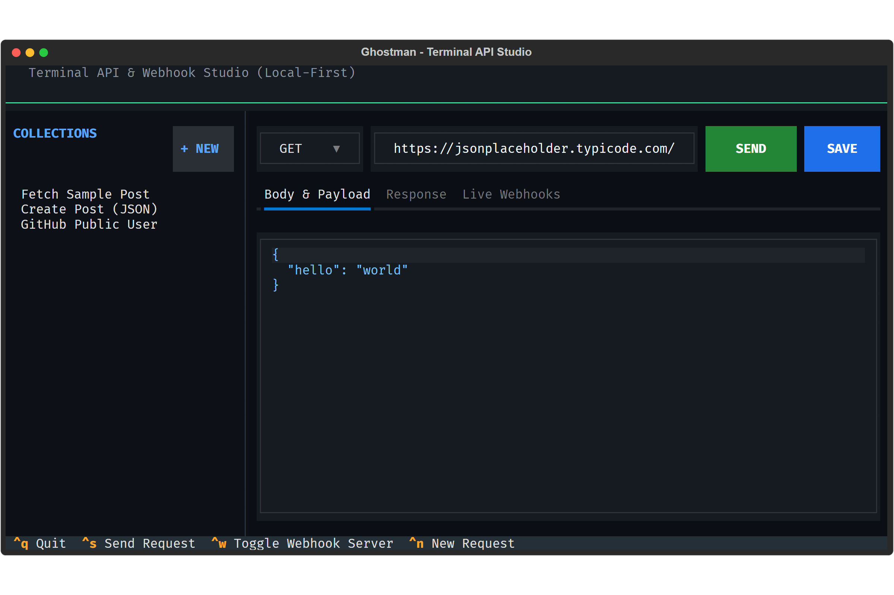

```
   ____ _               _                          
  / ___| |__   ___  ___| |_ _ __ ___   __ _ _ __   
 | |  _| '_ \ / _ \/ __| __| '_ ` _ \ / _` | '_ \  
 | |_| | | | | (_) \__ \ |_| | | | | | (_| | | | | 
  \____|_| |_|\___/|___/\__|_| |_| |_|\__,_|_| |_| 
                                                   
```

# Ghostman 👻

> **A fast, keyboard-driven terminal API client and webhook inspector.**  
> *No mandatory cloud accounts. No 1GB Electron bloat. 100% local-first.*

[](LICENSE)
[](https://www.python.org/)
[](https://github.com/Textualize/textual)

<p align="center">
  
</p>

---

## Why Ghostman?

Modern API clients started as simple developer utilities, but turned into heavy enterprise platforms:
- Mandatory cloud logins and team workspaces just to test local endpoints
- 800MB–1.5GB RAM consumption idling in the background
- Sluggish startup times
- Needing external tunnels (`ngrok`, `webhook.site`) just to inspect a local webhook

**Ghostman** is built for developers who live in their terminal:

- ⚡ **Instant Startup:** Launches in ~150ms directly inside your CLI.
- 🔒 **100% Local-First:** All collections live in `.ghostman/` on your disk (plain JSON or YAML). Check them into Git alongside your codebase.
- 🛰️ **Built-in Webhook Receiver:** Press `Ctrl + W` to spin up a local listener (`http://127.0.0.1:9090`) to catch, inspect, and replay webhooks in real-time.
- ⌨️ **Keyboard-Driven:** Navigate, compose JSON payloads, and fire requests without touching the mouse.

---

## Visual Tour

### 1. High-Speed Telemetry & Formatted Responses
Instant latency tracking, HTTP status badges, payload size metrics, and syntax-highlighted JSON rendering:
<p align="center">
  
</p>

### 2. Live Webhook Stream
Catch incoming HTTP callbacks from Stripe, GitHub, Shopify, or local microservices live:
<p align="center">
  
</p>

---

## Quick Start

### Requirements
- Python 3.10 or newer

### Installation

```bash
# Clone the repository
git clone https://github.com/4yk5/ghostman.git
cd ghostman

# Install dependencies
pip install -r requirements.txt

# Run Ghostman
python main.py
```

> **Windows:** You can also run Ghostman by double-clicking `run.bat` in the project root.

---

## Keyboard Shortcuts

| Keybinding | Action |
| :--- | :--- |
| `Ctrl + S` | **Send HTTP Request** (Executes request & switches to Response tab) |
| `Ctrl + K` | **Save Request** (Saves current endpoint to collections) |
| `Ctrl + N` | **New Request** (Resets input fields) |
| `Ctrl + W` | **Toggle Webhook Server** (Starts / Stops listener on port 9090) |
| `Tab` / `Shift + Tab` | Navigate between controls, inputs, and tabs |
| `Enter` | Select endpoint from sidebar / trigger button |
| `Ctrl + Q` | **Quit Ghostman** |

---

## Inspecting Webhooks Locally

1. Press `Ctrl + W` to turn on the webhook listener on port `9090`.
2. Point your webhook provider or test client to:
   ```bash
   curl -X POST http://127.0.0.1:9090/webhook \
     -H "Content-Type: application/json" \
     -d '{"event": "payment_succeeded", "amount": 4200}'
   ```
3. Switch to the **Live Webhooks** tab: inspect headers, path, timestamp, and payload.
4. Click any captured webhook to load its payload directly into the request editor.

---

## Contributing

Contributions, feedback, and pull requests are very welcome! Feel free to open an issue for bug reports or feature requests.

## License

Released under the [MIT License](LICENSE).
