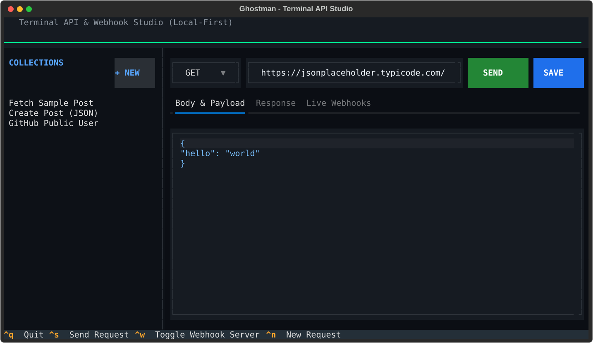
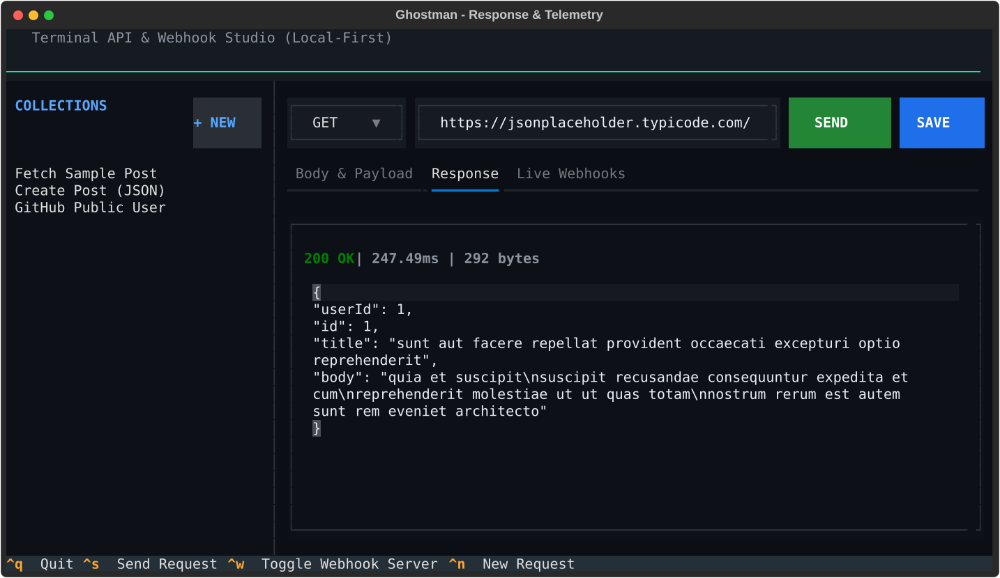
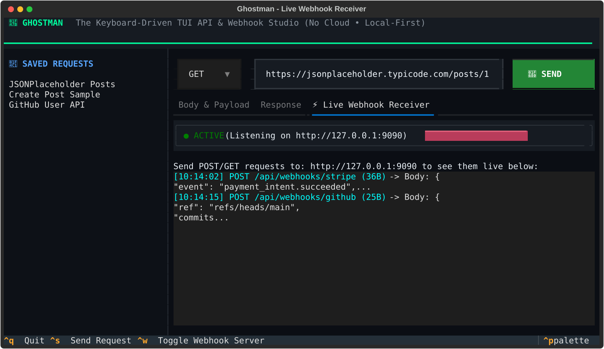

```
   ____ _               _                          
  / ___| |__   ___  ___| |_ _ __ ___   __ _ _ __   
 | |  _| '_ \ / _ \/ __| __| '_ ` _ \ / _` | '_ \  
 | |_| | | | | (_) \__ \ |_| | | | | | (_| | | | | 
  \____|_| |_|\___/|___/\__|_| |_| |_|\__,_|_| |_| 
                                                   
```

# 👻 Ghostman

> **A fast, keyboard-driven API client and webhook inspector right in your terminal.**  
> *No cloud accounts. No 1GB Electron bloat. 100% Local-first.*

[](LICENSE)
[](https://www.python.org/)
[](https://github.com/Textualize/textual)



---

## 💡 Why Ghostman?

Modern API clients like **Postman** and **Insomnia** started as lightweight developer utilities, but evolved into heavy enterprise platforms:
- ❌ Force cloud logins, team workspaces, and telemetry
- ❌ Consume 800MB - 1.5GB of RAM just idling in the background
- ❌ Sluggish startup times
- ❌ Require external tunnels (ngrok, webhook.site) just to inspect a local webhook callback

**Ghostman** is built from scratch for developers who want raw speed, terminal workflows, and complete local privacy:
- ⚡ **Instant Startup:** Launches in under 200ms directly in your terminal.
- 🔒 **100% Local-First:** All collections and requests live as plain YAML in `.ghostman/collections.yaml`. Check them into Git alongside your codebase.
- 🛰️ **Built-in Webhook Receiver:** Hit `Ctrl + W` to spin up an ephemeral server on `http://127.0.0.1:9090` to catch, inspect, and replay webhooks live on screen.
- ⌨️ **Vim & Keyboard-First:** Full keyboard navigation — switch collections, compose JSON bodies, and fire requests without touching the mouse.

---

## 📸 Interface Tour

### 1. High-Speed Response & Telemetry
Instant latency tracking in milliseconds, HTTP status badges, payload size metrics, and auto-formatted JSON syntax highlighting:


### 2. Live Webhook Stream
Catch incoming HTTP callbacks from Stripe, GitHub, Shopify, or local microservices in real-time:


---

## ⚡ Core Features

- **Full HTTP Method Suite:** Seamlessly compose `GET`, `POST`, `PUT`, `DELETE`, and `PATCH` requests with custom headers and raw JSON payloads.
- **Performance Telemetry:** Measure DNS + TTFB latency in real-time to monitor API endpoint bottlenecks.
- **Embedded Webhook Server:** No need to configure third-party reverse proxies during development; catch incoming webhooks locally.
- **Pretty JSON Formatting:** Automatically indents, formats, and colorizes JSON payloads with Pygments and Rich.
- **Collection Explorer:** Organize API endpoints into collections, persistent across sessions.
- **Cyberpunk Dark TUI:** Optimized contrast for developer eyes with high-DPI terminal support.

---

## 🚀 Quick Start

### Prerequisites
- Python 3.10 or newer

### Installation

```bash
# 1. Clone the repository
git clone https://github.com/4yk5/ghostman.git
cd ghostman

# 2. Install dependencies
pip install -r requirements.txt

# 3. Launch Ghostman
python main.py
```

> **Windows tip:** You can also simply double-click `run.bat` in the project root!

---

## ⌨️ Keybindings & Controls

| Shortcut | Description |
| :--- | :--- |
| `Ctrl + S` | **Send HTTP Request** (Executes call and switches to Response view) |
| `Ctrl + W` | **Toggle Webhook Server** (Starts / Stops receiver on port 9090) |
| `Tab` / `Shift+Tab` | Cycle focus between inputs, method selector, and tabs |
| `Enter` | Select collection item from sidebar |
| `Ctrl + Q` | **Quit Ghostman** |

---

## 🛠️ Testing Webhooks Locally

1. Press `Ctrl + W` inside Ghostman to start the receiver on port `9090`.
2. Point your webhook provider (or fire a test `curl` from another terminal) to:
   ```bash
   curl -X POST http://127.0.0.1:9090/api/webhooks/stripe \
        -H "Content-Type: application/json" \
        -d '{"event": "payment_intent.succeeded", "amount": 4900}'
   ```
3. Ghostman immediately captures the incoming request, displays the headers, and parses the payload live in the **Live Webhooks** tab.

---

## 📁 Git-Friendly Collections

Ghostman stores all your requests inside `.ghostman/collections.yaml` in clean, human-readable YAML:

```yaml
- name: "Authentication API"
  requests:
    - name: "Login User"
      method: "POST"
      url: "https://api.example.com/v1/auth/login"
      headers:
        Content-Type: "application/json"
      body: '{\n  "email": "user@example.com",\n  "password": "secretpassword"\n}'
```

Commit `.ghostman/` directly to your repository so your entire team can share the same API collections without needing cloud sync accounts.

---

## 🗺️ Roadmap

- [x] Async HTTP Engine (`httpx`) with latency telemetry
- [x] Ephemeral Webhook Receiver (`port 9090`)
- [x] Local YAML collection persistence
- [x] Dark cyber TUI theme with auto JSON styling
- [ ] 1-Click "Replay captured webhook as outbound request"
- [ ] Dynamic environment variables (`{{BASE_URL}}`, `{{AUTH_TOKEN}}`)
- [ ] Export requests to cURL format (`Ctrl + C`)
- [ ] Standalone binary release (zero Python install required)
---

## 📄 License

This project is licensed under the MIT License - see the LICENSE file for details.  
Copyright © 2026 **4yk5**. All rights reserved.
